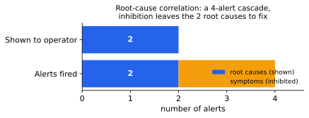
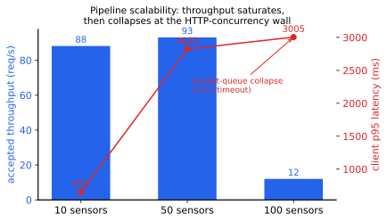
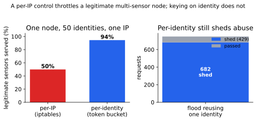
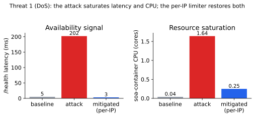

# REPORT additions — measurement-rigor pack

**Status:** drop-in sections for `report/REPORT.md`, kept separate to avoid edit
collisions while the main report is being revised. Each section says where it belongs.
Every number here traces to a capture script and a raw evidence file (see §E, the
evidence map). Dated 2026-11-25; all runs on the isolated Incus lab inside the VM.

These additions were inspired by the measurement approach in a peer report for the same
course (measured — not asserted — attack surface; a demonstrated root-cause correlation;
a scalability study whose result feeds back into the security design). The architecture,
threats, scripts and conclusions here are this project's own.

---

## A. Measured attack surface  *(replaces the prose "Attack surfaces." paragraph in §4)*

Rather than list the attack surface on paper, a throwaway **probe**
(`threats/00-attack-surface/probe.sh`) sends one real request per candidate exposure from
the realistic adversary position — already on the service network, holding no credentials,
running *inside* `soa-container` because the registry and storage replicas are
localhost-bound and only reachable after a foothold — and records whether each is
confirmed or blocked. It confirmed **6 of 7**:

| # | Exposure | Probe request | Result | Evidence |
|---|----------|---------------|--------|----------|
| 1 | **Discovery poisoning** | `POST /register` a decoy, then `GET /discover` | **Confirmed** — `/discover` handed clients the attacker URL | `discover → …analytics-service#decoy` |
| 2 | **One-request DoS** | `DELETE /unregister` a live instance | **Confirmed** — one request evicts it (restored after the check) | evicted `…storage-service#5002` |
| 3 | **Forged data** | `POST /ingest` a plausible reading from a ghost device | **Confirmed** — accepted (HTTP 200) | shape/range *is* validated (999.9 → 400); **identity is not** |
| 4 | **Topology leak** | `GET /services` | **Confirmed** — returns the labelled rack/node map | 4 instances, locations `pt.aveiro.dc1.rack01.node01`, … |
| 5 | **Open monitoring plane** | unauth `GET` Prometheus / Wazuh API | **Prometheus confirmed** (`/api/v1/query` → 200, alerts readable); Wazuh API auth-gated | an attacker can read metrics/alerts |
| 6 | **Plaintext transport** | `http` vs `https` to a service | **Confirmed** — plain HTTP, HTTPS refused (ties to Threat D) | `http …/health → 200`, `https → refused` |

**Controls that held** (also recorded by the probe): lab isolation (no egress),
unprivileged systemd-hardened containers, and the **localhost-binding** of the registry
and storage replicas, which keeps them off the pre-foothold surface. Finding #3 is more
precise than a blanket "no validation": ingestion *does* validate the reading's shape and
physical range, but not the device's identity — so a forged value within range is stored
indistinguishably from a real one. That nuance motivates the per-identity control in §D.

Each confirmed exposure is a leaf in the consolidated tree (§B) and a ranked item in the
residual-risk list.

---

## B. Consolidated attack–defense tree and ranked residual risk  *(new subsection for §4)*

The per-threat ADTrees in §4.1–4.4 condense into one tree. `[impl]` = a deployed control
with a test that verifies it; `[gap]` = a weakness left open on purpose; `C` = a
counter-defense (how an attacker defeats the control above it).

```
Goal: compromise the telemetry SOA
├─ A1 Deny service (OR)                     [impl] per-identity limiter (§D) + Wazuh firewall-drop
│    ├─ Flood the expensive endpoint         [impl] Prometheus QoS alerts + per-IP rate-limit
│    │                                        C: distributed flood keeps each IP under quota
│    └─ One-request kill (/unregister)        [gap] registry write endpoints unauthenticated (probe #2)
├─ A2 Persistent control / C2 (AND)         [impl] FIM + port-agnostic egress detection + auto-contain
│    ├─ Deliver + run payload                 [impl] FIM on drop dirs; no toolchain in image
│    ├─ Reverse-shell egress                  [impl] detect any unexpected egress; kill + block
│    │                                        C1: HTTPS C2 on :443 blends in   C2: memory-only payload
│    └─ Persistence                           [gap] autostart FIM only; no re-image
├─ A3 Intercept traffic / MitM (OR)         [impl] route-hijack detection (extra hop, TTL=63)
│    └─ Read/alter plaintext HTTP             [gap] no TLS between services (probe #6)
│                                             C: TLS + pinning/HSTS would close it (future work)
└─ A4 Corrupt / forge data (OR)             [impl] shape + physical-range validation at ingestion
     ├─ Forge a reading                        [gap] no device authentication (probe #3)
     └─ Poison discovery                        [gap] registry write endpoints unauthenticated (probe #1)
```

**Ranked residual risk** (by ease of attack × impact; each is the bridge to Project 2's
attack-tolerance work):

1. **No auth on the registry's write endpoints** — `/register`, `/unregister` enable
   discovery poisoning and a one-request DoS (probe #1, #2).
2. **No auth on the monitoring plane** — the Prometheus API is an open read, and (in a full
   deployment) Alertmanager silences would let an attacker mute their own detection (probe #5).
3. **No device authentication at ingestion** — forged readings are accepted (probe #3).
4. **No TLS between services** — plaintext is readable and alterable on-path (probe #6, Threat D).
5. **Registry is a single in-memory point of failure** — it also loses state on restart.
6. **Single-node SIEM / single central Prometheus** — availability couples to one host.
7. **Behavioural C2 detection is evadable** — HTTPS-on-:443 or a memory-only payload.

Item previously ranked for per-client rate limiting was **closed** during the DoS work and
is now an `[impl]` node with its own counter-defense (distributed flood) — see §D.

---

## C. Root-cause correlation, demonstrated  *(new "Correlation" subsection for §5)*

§4 argues that correlating performance and security monitoring turns a symptom into a
cause. This now runs as a measured demo (`tools/correlation-demo.sh`), using **Alertmanager
inhibition rules** (`monitoring/alertmanager.yml`, installed by
`monitoring/install-alertmanager.sh`) that this project added to the Prometheus plane.

A failure in a service-oriented architecture produces a *cascade* of alerts: the one broken
dependency plus every downstream symptom. Injecting a single fault — a **storage-tier
outage** (both SQLite replicas stopped) — fired **4 alerts**: 2 root causes
(`ServiceDown` on each storage replica) and 2 downstream symptoms (`HighErrorRatio` on the
ingestion and analytics services, which depend on storage). The inhibition rules suppress a
symptom while its cause is firing, so Alertmanager showed the operator **only the 2 causes**
and hid the 2 symptoms — the fault to fix, not its consequences.



*Figure C1 — A 4-alert cascade from one injected fault; inhibition leaves only the 2 root
causes the operator must act on. Raw numbers: `evidence/correlation-20261125-131158.txt`.*

**Design note.** The causes (`ServiceDown`, `RegistryDown`) and symptoms
(`HighErrorRatio`, `HighLatency`, `QoSDegraded_AnalyticsLatency`, …) were already separated
by the existing alert rules; the inhibition rules only had to name which mutes which. A
second experiment confirmed the dual: stopping the **registry** makes the pipeline go
*silent* rather than error (clients can no longer discover each other), so only
`RegistryDown` fires — a clean single cause with no cascade to collapse. **The cascade's
size scales with the number of instances** (one symptom per dependent service), which is why
correlation matters more as the system grows — the link to the scalability study in §D.

---

## D. Scalability, measured — and why controls must key on identity  *(expands §5 "Scalability")*

The §5 scalability discussion is now backed by measurement. One node was made to host *N*
sensors (N distinct hierarchical identities behind one source IP) and the ingestion pipeline
measured at N = 10 / 50 / 100 (`tools/scalability-sweep.sh`, `tools/load_sensors.py`):

| Sensors | Throughput (req/s) | p50 (ms) | p95 (ms) | soa CPU (cores) |
|---|---|---|---|---|
| 10 | 88 | 23 | 651 | 0.99 |
| 50 | 93 | 73 | 2823 | 1.06 |
| 100 | **12** | 3002 | 3005 | 0.59 |

Throughput saturates near **90 req/s at roughly one core** (the Flask/GIL path plus a
synchronous storage POST per request), and at 100 concurrent closed-loop clients it
**collapses to 12 req/s** with latencies pinned at the 3 s client timeout: the connection
burst overruns the HTTP server's accept queue, threads stall in timeout (so CPU *drops*),
and the pipeline stops making progress. Raising server concurrency (worker pool, async I/O,
or a reverse proxy) is the documented next step.



*Figure D1 — Throughput saturates then collapses at the HTTP-concurrency wall.
Source: `evidence/scalability-20261125-131744.csv`.*

### The security finding: per-IP controls misfire at scale

The scale test exposes a security lesson. The DoS defense (`monitoring/remediate.sh`) is an
`iptables` hashlimit keyed on **source IP**. But one node hosts many sensors, so its
*aggregate* connection rate trips a per-IP limit even though every individual sensor is
well-behaved — the control then denies the very service it protects. Measured with 50 legit
sensors from one IP (`tools/identity-vs-ip-demo.sh`):

| Control | Legit sensors served | Throughput (req/s) | Flood reusing one identity |
|---|---|---|---|
| **per-IP** (iptables hashlimit) | **49.9 %** (685 SYNs dropped) | 11 | n/a |
| **per-identity** (token bucket, keyed on `device_id`) | **94.5 %** | 70 | **shed: 682 × HTTP 429** |

Keying the limiter on the sensor's **hierarchical identity** instead of its address
(`architecture/ratelimit.py`, env-gated hook in `ingestion_service.py`, default off) gives
each sensor its own token bucket (5 req/s, burst 10): the legitimate node is served, and a
flood that reuses a single identity is still shed. This closes the project's own stated
future-work item ("per-identity rate limits") and ties the scalability result straight back
into the security design.



*Figure D2 — A per-IP control throttles a legitimate 50-identity node (49.9 % served);
keying on identity serves it (94.5 %) and still sheds a single-identity flood.
Source: `evidence/identity-vs-ip-20261125-132041.txt`.*

**Honest residue.** The per-identity run still shows ~5 % legit failures and a p95 at the
timeout, because the HTTP-concurrency wall from Figure D1 is a *different* bottleneck: the
limiter fixes the false positive, not the server's accept-queue ceiling. The two controls
protect different properties — integrity of the data store (the limiter) versus availability
under a connection burst (server concurrency) — and neither substitutes for the other.

A companion figure records Threat 1's before/after for reference:



*Figure D3 — Threat 1 (DoS): the attack saturates `/health` latency (5→202 ms) and CPU
(0.04→1.64 cores); the per-IP limiter restores both (3 ms, 0.25 cores).
Source: `threats/01-ddos/evidence/`.*

---

## E. Evidence map  *(extends the "Reproducibility" section)*

Every figure and headline number above traces to a capture script and a raw file. Prometheus
rates/percentiles are estimates over a window; exact counts come from the services and the
evidence files.

| Report item | Produced by | Raw evidence |
|---|---|---|
| §A measured attack surface (6/7) | `threats/00-attack-surface/probe.sh` | `evidence/attack-surface-20261125-130210.txt` |
| Fig C1 correlation (4 alerts → 2 causes) | `tools/correlation-demo.sh` + `monitoring/alertmanager.yml` | `evidence/correlation-20261125-131158.txt` |
| Table D / Fig D1 scalability (10/50/100) | `tools/scalability-sweep.sh`, `tools/load_sensors.py` | `evidence/scalability-20261125-131744.csv` |
| Table D / Fig D2 identity-vs-IP | `tools/identity-vs-ip-demo.sh`, `architecture/ratelimit.py` | `evidence/identity-vs-ip-20261125-132041.txt` |
| Fig D3 DoS before/after | `threats/01-ddos/run.sh`, `monitoring/remediate.sh` | `threats/01-ddos/evidence/*.txt` |
| All four figures | `tools/make-figures.py` (host-side) | `report/figures/fig_*.svg` |
| Threats 2/3/4 PoCs | `threats/0{2,3,4}-*/…` | `threats/0{2,3,4}-*/evidence/` |
| SIEM rules + active response | `siem/install_siem.sh` | Wazuh manager alerts |

## F. Declaration on the Use of AI

An AI coding assistant was used throughout this project as a productivity tool, under the
author's direction and review. It supported: **implementing the services** (SOA registry,
ingestion, storage, analytics, sensors and their instrumentation); **generating the tests and
load/attack drivers**; **implementing the threat PoCs** (DDoS, spam, C2, on-path MitM) with
their detections and active responses; **running the experiments and collecting the results**
reported here (attack-surface probe, correlation demo, scalability and identity-vs-IP studies);
and **drafting the report**. All generated artefacts were read, tested on the live lab,
corrected and validated by the author, who takes full responsibility for the design,
measurements and claims.
