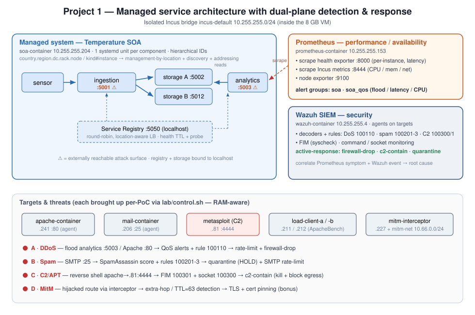

# Threat Detection, Monitoring and Prevention in a Large-Scale Service Architecture

**SSLE — Project 1** · 2026-11-24

---

## Abstract

We design and operate a service-oriented architecture (SOA) that scales horizontally and
is instrumented for both *performance* and *security* observability, and we exercise it
against four network threats: a distributed denial of service, an email spam campaign, a
command-and-control (C2) channel, and a man-in-the-middle interception (the last as a
bonus). For each threat we build the attack, detect it with Prometheus and/or the Wazuh
SIEM, correlate symptoms to a root cause following the FCAPS fault-management workflow, and
apply an automatic or operator action-response. Every result is reproduced on an isolated
Incus lab inside a single VM and backed by captured evidence.

---

## 1. Introduction

Large-scale operators run thousands of service instances; attacks are inevitable and
mostly leave resource traces even when logs are tampered with. The problem is therefore not
only *prevention* but **detection at scale** and **fast localization** of the incident
source. This project builds a representative (small but structurally faithful) system and
shows, end to end, how three required threat classes — plus one bonus — are detected,
correlated and mitigated. We reuse the tools from the practical guides: Incus (VIM), a
Python SOA, Prometheus (monitoring) and Wazuh (SIEM).

Contributions:
- A horizontally-scalable SOA with hierarchical, location-aware naming that makes incident
  localization cheap.
- A two-plane monitoring stack: Prometheus for availability/performance, Wazuh for security
  events, both wired to the same managed system.
- Four worked threats with reproducible PoCs, detection rules, action-responses and honest
  post-mortems.

---

## 2. Relevant State of the Art

- **FCAPS (ISO/IEC 7498-4)** — the telecom management model. We focus on *Fault*
  management (Detect → Isolate/Diagnose → Correlate → Resolve/Mitigate → Post-mortem) and
  note that FCAPS Fault does **not** cover explicit security events, which is why a SIEM is
  added alongside.
- **ETSI NFV / VIM** — virtual infrastructure managed by a VIM; here Incus plays the VIM
  role (containers as virtualized network functions).
- **Attack-surface & Attack-Defense Trees** — MITRE CAPEC domains (communications, software,
  social engineering) frame the threats; ADTrees (Kordy et al.) structure attacker goals vs
  defenses and are used per threat in §4.
- **Monitoring**: Prometheus (pull-based time series, exporters, alerting) is the de-facto
  cloud-native standard; Wazuh (open-source SIEM, fork lineage from OSSEC) provides log
  management, decoders/rules, FIM and active-response. SpamAssassin (Bayesian + rule
  scoring) and Metasploit (C2/offensive tooling) are standard references for the spam and
  C2 threats respectively.

---

## 3. Service Architecture Used



*Figure 1 — The managed temperature SOA on the isolated Incus bridge, monitored by two
planes (Prometheus for performance/availability, Wazuh for security), with the four threats
and their detection/response paths. Only externally reachable services (⚠) are attack
surfaces; the registry and storage replicas are localhost-bound.*

The managed system is a temperature-telemetry SOA (from Guide 1), deployed in
`soa-container` and run as one `systemd` unit per component:

```
 sensor → ingestion(:5001) → storage ×2 (:5002/:5012, SQLite) ← analytics(:5003)
                        ↖ discover/register ↑
                   Service Registry (:5050, round-robin LB, health TTL + active probe)
```

**Scalability & large-scale properties (project "key aspects"):**
- **Identification/registration** — every instance has a hierarchical ID
  `country.region.datacenter.rack.node / service-kind # instance`
  (e.g. `pt.aveiro.dc1.rack02.node04/storage-service#5012`). The prefix supports
  *management by location*, the kind supports *discovery*, the suffix gives *addressing*.
- **Physical vs logical placement** — the location prefix encodes datacenter/rack/node;
  the registry can filter/aggregate per location (`/services?location=pt.aveiro.dc1`).
- **Delegation & load balancing** — discovery is round-robin and *location-aware*
  (`near=` prefers same-rack/same-DC instances), so traffic and bandwidth stay local.
- **Fast incident localization** — because IDs carry location, an alert naming a
  `service_id` immediately tells you *where* (which rack/node) to look — the project's
  "quickly locate event/incident source" requirement.

**Monitoring planes:**
- *Prometheus* (`prometheus-container`) scrapes a custom health/application exporter
  (per-instance liveness, request/error/latency), the **Incus metrics endpoint**
  (per-container CPU/mem/net — more accurate than an in-container node exporter, whose CPU
  readings are wrong under LXC), and a node exporter. Location labels allow
  bandwidth-optimized, per-location aggregation (bonus).
- *Wazuh* (`wazuh-container`) runs agents on the targets and provides decoders, correlation
  rules, FIM and active-response.

Full addressing: wazuh .4, prometheus .153, soa .204, apache .241, mail .206, C2 .81, all
on the isolated `incus-default` bridge 10.255.255.0/24.

---

## 4. Risk Management and Mitigation

**Attack surfaces.** Externally reachable: ingestion `:5001`, analytics `:5003` (the
expensive `/anomalies`), Apache `:80`, the mail server `:25`. Not reachable (bound to
localhost): the registry and the storage replicas — a deliberate reduction of the attack
surface. No authentication or TLS between services is the main residual weakness.

**Large-scale monitoring.** Detection is layered: Prometheus catches
availability/performance anomalies (rate, latency, saturation) in seconds; Wazuh catches
security events (log patterns, file changes, suspicious connections). Correlating the two
in the same time window is what turns a *symptom* into a *root cause*.

Per-threat Attack-Defense Trees are given inline below (root = attacker goal; `-->`
refinement; `..>` defense).

---

## 4.1 Threat A — Massive Denial of Service (DDoS)

**Description & relevance.** Availability attack: exhaust CPU/workers/connections so
legitimate users are denied service. Relevant because the analytics `/anomalies` endpoint
is expensive (reads ≤1000 rows + statistics per call) — a natural pressure point for a
large-scale telemetry service.

**ADTree.**
```
Deny analytics availability
 --> Flood expensive endpoint (/anomalies)      ..> per-IP rate limit; QoS alert
 --> Many sources at once (distributed)          ..> upstream filtering / autoscaling / reputation
 --> Exhaust connections                         ..> reverse-proxy timeouts, conn limits
```

**Exploitation.** Two lab containers (`load-client-a/b`) run ApacheBench against the
analytics endpoint; two simultaneous sources emulate a small botnet. Bounded and time-boxed.

**Monitoring (Prometheus, group `soa_qos`).** `DoS_RequestFlood` (rate > 10 req/s, baseline
< 0.2), `QoSDegraded_AnalyticsLatency` (`/health` probe latency > 0.05 s, baseline ~0.005 s),
`DoS_TargetCPUSaturated` (container CPU > 0.8 core). Alert window `for: 30s` so a flash crowd
does not page; Prometheus auto-resolves on recovery. **Wazuh (SIEM)** adds rule 100110: an
HTTP flood (≥60 requests/10 s from one source) on Apache's access log.

**Correlation.** Alert on analytics QoS + request flood → victim = analytics (and,
downstream, storage, which also showed ~65 req/s = the fan-out) → source container whose
egress and CPU rose in the same window → the two ApacheBench clients.

**Action-response.** Prometheus side: per-IP rate limit (`remediate.sh`, iptables hashlimit).
Wazuh side: `firewall-drop` blocks the flooding IP on rule 100110.

**Post-mortem (evidence `threats/01-ddos/evidence/`).** Baseline p95 33 ms → attack p95
488 ms; `/health` 4 ms → 202 ms; CPU 0.06 → 1.64 cores; rate 1 → 61 req/s. All three QoS
alerts fired and auto-cleared on recovery. With the rate limit: attacker capped 30 → 10
req/s, CPU held at 0.25 cores, legitimate client still served in 17 ms, 958 SYNs dropped.
**Limitation:** a per-IP limit does not stop a *distributed* flood (each IP keeps its quota)
— the real defense is upstream/reputation/autoscaling. Also: ApacheBench's "failed"
(length-mismatch) count with non-2xx = 0 shows *throughput alone does not prove availability
loss* — latency and saturation do.

---

## 4.2 Threat B — Junk Email / Spam

**Description & relevance.** Unsolicited mail: social-engineering fraud (phishing lures) and
volume (availability/storage/cost). A multi-tenant operator must filter, quarantine and
rate-limit.

**ADTree.**
```
Deliver spam / abuse the MTA
 --> Social-engineering content                  ..> SpamAssassin scoring + quarantine
 --> High volume                                 ..> SMTP per-client rate limit (anvil)
 --> Reuse sending IP                            ..> reputation blocklist (CDB / Bayes)
```

**Architecture.** `mail-container`: Postfix (MTA) + Dovecot (IMAP/POP3) + SpamAssassin, with
`smtpd → content_filter=spamassassin → spamc → spamd`. A readying bug was found and fixed:
spamd was not running (on Ubuntu the unit is `spamassassin.service`, configured via
`/etc/default/spamassassin`, not the guide's `/etc/default/spamd`).

**Exploitation (`spam.py`).** `gtube` (deterministic spam), `social` (Nigerian prince,
lottery/10000th-visitor, bank phish), `volume N` (flood).

**Monitoring (Wazuh).** A PCRE2 decoder extracts the SpamAssassin score from spamd's
mail-log line; rules 100201 (any spam), 100202 (high-confidence, score ≥ 100), 100203
(campaign: ≥10 spam in 60 s).

**Action-response (`mail_controls.sh`).** Quarantine flagged mail to the HOLD queue
(`header_checks`), and a Postfix anvil per-client SMTP rate limit. Reputation ties in via
SpamAssassin Bayes (content) and the Guide-4 CDB blocklist pattern (sender IP).

**Post-mortem (evidence `threats/02-spam/evidence/`).** GTUBE scored 1003/5.0; 16 spam sent
with quarantine on → 16 held, 0 delivered; rules 100201/2/3 all fired (campaign confirmed on
agent mail-container). Rate limit: 15 messages → 10 accepted, 5 rejected. **Limitation:**
GTUBE guarantees a verdict; real spam needs trained Bayes and risks false positives — hence
quarantine (reversible) over hard reject.

---

## 4.3 Threat C — Command-and-Control / Botnet (APT)

**Description & relevance.** A C2 server remotely controls compromised hosts (a botnet, e.g.
to launch Threat A). A reverse shell gives interactive control through outbound-only
firewalls. Detecting and cutting the channel limits an APT.

**ADTree.**
```
Establish & keep C2 on a host
 --> Deliver + run payload                       ..> FIM on drop dirs; execution monitoring
 --> Reverse shell egress to C2                   ..> detect unexpected egress; kill + block
 --> Persistence (cron/systemd)                   ..> FIM on autostart; re-image
```

**Safety.** All traffic stays on 10.255.255.0/24 inside the VM; `payload.sh` refuses any
non-lab `LHOST`. (UA firewalls block external Metasploit traffic.)

**Exploitation (Guide 8).** Kali `metasploit-container` C2; `msfvenom` x64 reverse_tcp
payload; `multi/handler` listener; payload executed on the victim `apache-container` → a
meterpreter session over the bridge.

**Monitoring (Wazuh, two angles).** 100301 — FIM realtime on `/root/loot` catches the
payload drop. 100300 — command monitoring (`ss … dst :4444` every 15 s, child of the
built-in full_command rule 530) catches the live C2 connection.

**Action-response (`c2-contain.sh`, automatic on 100300).** Kill the shell process and drop
egress to tcp/4444 on the victim.

**Post-mortem (evidence `threats/03-c2/evidence/`).** Session opened
(10.255.255.81:4444 → 10.255.255.241); FIM (100301) and C2 (100300) alerts both fired on
the victim agent; containment killed the process and blocked egress; re-run payload →
0 connections. **Limitations:** detection latency ≈ one 15 s cycle; keying on the fixed port
4444 is demo-grade (a real adversary randomizes ports / uses 443 — baseline unexpected
egress instead); containment cuts the channel but not persistence — a full IR adds autostart
FIM and re-imaging.

---

## 4.4 Threat D — Man-in-the-Middle / Route hijacking (bonus)

**Description & relevance.** An on-path attacker intercepts/alters traffic. Relevant to the
"route and signals hijacking" syllabus item.

**ADTree.**
```
Intercept client↔service traffic
 --> Become the route (gateway/hop)              ..> routing hardening; detect extra hop/TTL
 --> Read/alter HTTP                             ..> TLS everywhere
 --> Present a bogus certificate                  ..> cert pinning / HSTS
```

**Exploitation & status — implemented and demonstrated.** An isolated second subnet
(`mitm-net`) places `mitm-client` so its only route to Apache is through `mitm-interceptor`
(a hijacked route; no ARP spoofing). The interceptor forwards (`ip_forward` + MASQUERADE) and
captures the traffic: the full plaintext was recovered in transit — `GET / HTTP/1.1`,
`HTTP/1.1 200 OK`, `Server: Apache/2.4.52`, the page body — proving an on-path attacker reads
(and could alter) unencrypted traffic.

**Detection.** Client-side: `traceroute` shows an extra hop (10.66.0.2, the interceptor) and
replies arrive with `ttl=63` instead of 64 (one extra forwarding hop) — the route-hijack
signal.

**Action-response.** TLS + certificate pinning / HSTS (defeats reading and makes an active
MitM's substitute certificate fail), and routing hardening (`accept_redirects=0`,
authenticated routes). Evidence: `threats/04-mitm/evidence/`. *(Active content modification
would use a transparent proxy; mitmproxy is unpackaged on Debian trixie, so read-interception
is shown via packet capture — the confidentiality break is identical.)*

---

## 5. Evaluation of the solution's approaches and scalability

**Effectiveness.** Each required threat is detected *and* mitigated, verified with evidence:
DoS QoS alerts + rate-limit (CPU 1.64 → 0.25 cores under attack); spam fully quarantined and
rate-limited; C2 channel detected and auto-severed in ≤15 s. Correlating Prometheus
(performance) with Wazuh (security) is what localizes root cause — e.g. the DoS flood seen
simultaneously as rising analytics rate, storage fan-out, container CPU and client egress.

**Scalability.**
- *Monitoring*: Prometheus pull + per-location labels scale horizontally; the Incus metrics
  endpoint gives per-container data without an agent per container. Location-aware discovery
  keeps traffic/bandwidth local (bonus "monitor by location").
- *Naming*: hierarchical IDs make per-location filtering and incident localization O(prefix)
  rather than O(instances).
- *Detection*: Wazuh frequency rules and `same_source_ip` correlation scale to many agents;
  active-response is per-agent and local.
- *Limits observed*: on an 8 GB single VM the whole stack cannot run at once (Wazuh indexer
  alone ≈ 2.3 GB); we sequence PoCs with `lab/control.sh`. At true scale the indexer and
  Prometheus would be their own clusters — a known, documented constraint, not a design flaw.

**Honest weaknesses.** No inter-service auth/TLS; per-IP controls don't stop distributed
attacks; C2 detection keys on a fixed port; single-node SIEM. These are the right next steps.

---

## 6. Conclusions

A structurally-faithful large-scale SOA was built, instrumented on two planes and defended
against four threats with reproducible PoCs, SIEM integration and action-responses, all
following the FCAPS fault workflow. The main findings: (1) location-aware hierarchical
naming makes incident localization cheap; (2) *performance* and *security* monitoring must
be **correlated** to move from symptom to cause; (3) every mitigation has a cost and a gap —
documenting the gap (distributed DoS, spam false positives, C2 persistence, single-node
SIEM) is itself a result. **Future work:** mTLS + per-identity rate limits, a reputation
service shared across threats, flow-based C2 detection, and clustering the SIEM/monitoring
for real scale (bridging toward Project 2's attack-tolerance mechanisms).

---

### Reproducibility
`lab/genesis.sh` rebuilds the core; `siem/install_siem.sh` installs all detection/response;
`threats/*/README.md` run each PoC; `threats/*/evidence/` hold the raw captures summarized
here.
